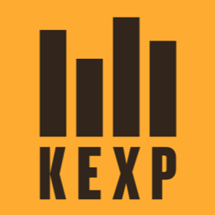

<p align="center">
  
</p>

# KEXP for Lyrion

A [Lyrion Music Server](https://lyrion.org) plugin for [KEXP](https://kexp.org): the live stream, every show from the last two weeks of the archive, and every Live on KEXP session.

- **Listen Live** — the 160 kbps AAC stream, with the current song, album art, show and DJ from KEXP's playlist
- **Live on KEXP** — every studio session from the podcast (2013 → now): latest 50, by year, or search by artist. Each session shows its description and setlist (found for ~96% of sessions)
- **Recent Shows** — browse by day (station time, Pacific)
- **Programs** — browse by program (Audioasis, Wo' Pop, Expansions, …). Each has a **Latest Episode** entry that always plays the newest show: favourite it, or use it for an alarm
- **Genres** — archive shows grouped by genre (Jazz, Hip Hop, Metal, Post-Punk & Synth, …), built from KEXP's program tags
- Each show opens to its tracklist. Play the whole show, or jump straight in at any song.
- While an archived show plays, now-playing shows the song that was on air at that moment (title, artist, album art), pulled from KEXP's playlist data.
- Archive shows start at 0:00 and run the length of the show (the archive's 10-minute lead-in is hidden), and seeking works.
- **Donate to KEXP** — opens kexp.org/donate in Material Skin; other players show the address.
- **Settings → Plugins → KEXP** shows the installed version, with Donate and project links, and lets you choose whether KEXP appears under **Radio** (default) or **My Apps**.
- A monochrome icon for Material Skin that follows its light and dark themes, or the orange logo if you prefer (settings). Material always draws Radio icons in monochrome, so the orange logo shows in Material when KEXP is in My Apps. Other skins use the orange logo.

## Works with LyrionJS

Tested with [LyrionJS](https://github.com/JameZUK/LyrionJS) (browser as player): archive shows (including
start offsets and seeking), Live on KEXP sessions, and the live stream all play through LMS's proxied
streaming, and the menus work in LyrionJS's own look as well as in Material Skin. *Donate* opens
kexp.org/donate in both, from LyrionJS 0.2.33 on ([thanks for the quick fix](https://github.com/JameZUK/LyrionJS/issues/16)).

## Install

In Lyrion: *Settings → Manage Plugins*, scroll to the bottom, and add this repository URL:

```
https://raw.githubusercontent.com/Ethros19/lyrion-kexp/main/repo.xml
```

Save, find **KEXP** in the plugin list, tick it, apply, and restart when prompted. It shows up under **Radio** (switchable to My Apps in its settings).
Updates appear in the same place after a new release.

## Release

Bump `<version>` in `src/KEXP/install.xml`, commit, then `./scripts/release.sh`
(builds the zip, regenerates `repo.xml`, tags, pushes, and creates the GitHub release).

## Develop

```sh
./scripts/dev-server.sh          # LMS on http://localhost:9000 with the plugin mounted
docker restart kexp-lms          # reload after editing Perl
docker logs -f kexp-lms          # plugin logs at INFO
./scripts/test-player.sh         # headless player for CLI testing
./scripts/lms.sh 00:11:22:33:44:55 '["kexp","items",0,10]'   # browse via JSON-RPC
prove tests/                     # unit tests for the pure helpers
```

See `CLAUDE.md` for notes on how the KEXP archive API behaves.

## License

Copyright (C) 2026 Ethan Rosch

This plugin is free software, licensed under the [GNU General Public License, version 2](LICENSE)
or (at your option) any later version, the same license family as Lyrion Music Server itself.

This is an unofficial, fan-made plugin, not affiliated with or endorsed by KEXP. The KEXP name and
logo are KEXP's, and aren't covered by this license. All audio and playlist data come from KEXP's
public services. If you enjoy it, please [support KEXP](https://www.kexp.org/donate/).
